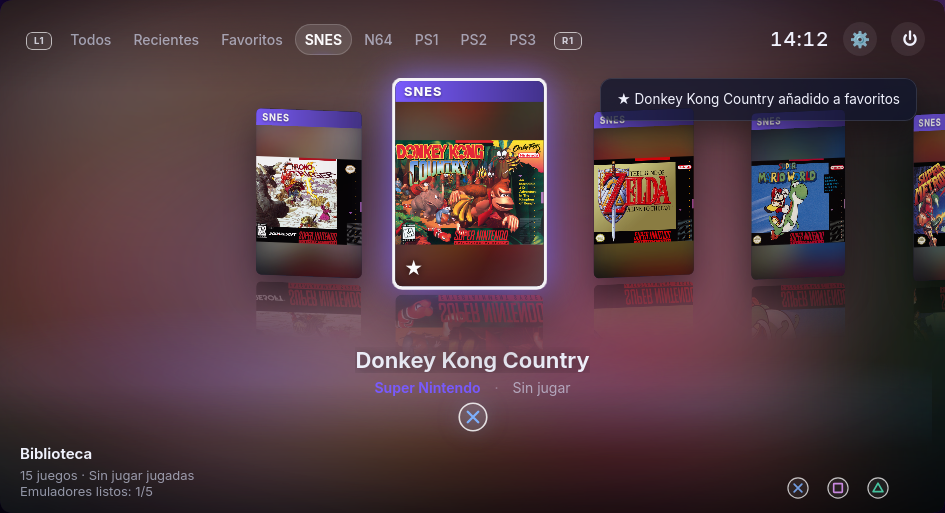

<div align="center">

# EmuHub

**Tu colección retro, en un solo lugar.**
Un lanzador de código abierto que reúne SNES, Nintendo 64, PlayStation, PlayStation 2 y PlayStation 3
bajo una interfaz de consola moderna, con los emuladores ya incluidos.

[Descargar](../../releases) · [Cómo funciona](#cómo-funciona) · [Hoja de ruta](#hoja-de-ruta) · [Compilar](#compilar-desde-el-código)



</div>

---

## Por qué existe

Jugar a clásicos en un PC hoy significa instalar cinco emuladores distintos, cada uno con su
interfaz, su configuración, sus carpetas de BIOS y sus atajos. Si además quieres jugar con amigos,
cada uno acaba con versiones diferentes, configuraciones incompatibles y una tarde perdida
intentando que todo funcione igual en todos los ordenadores.

EmuHub nace para resolver eso:

- **Un único sitio para toda tu colección.** Tus juegos de cinco consolas, con portadas, favoritos,
  recientes y tiempo jugado, en un carrusel pensado para jugar desde el sofá con mando.
- **Los mismos emuladores para todos.** Cada release trae versiones fijadas (con checksum verificado)
  de emuladores de código abierto, embebidas en un solo ejecutable. Si tú y tus amigos usáis la misma
  versión de EmuHub, usáis exactamente los mismos emuladores.
- **Cero configuración para empezar.** Abres el ejecutable, apuntas a tu carpeta de juegos y juegas.
  EmuHub sabe cómo lanzar cada emulador con los parámetros correctos.
- **Construido sobre el ecosistema open source.** Snes9x, RMG/Mupen64Plus, ares, DuckStation, PCSX2 y
  RPCS3 son el resultado de décadas de trabajo de la comunidad. EmuHub no los sustituye: los reúne,
  los presenta bien y da crédito y enlace al código de cada uno.

La preservación del videojuego depende de que estos clásicos sigan siendo **jugables** y **fáciles de
compartir como experiencia**. EmuHub quiere ser la puerta de entrada.

## Qué incluye

| | SNES | N64 | PS1 | PS2 | PS3 |
|---|---|---|---|---|---|
| **Windows / Linux** | Snes9x 1.63 | RMG 0.9.0 | DuckStation v0.1-12083 | PCSX2 2.8.2 | RPCS3 0.0.43 |
| **macOS** | Snes9x 1.63 | ares v148 | DuckStation v0.1-12083 | PCSX2 2.8.2 | RPCS3 0.0.43 |

Para las salas en línea, las releases de Windows y Linux incluyen además **Sunshine 2026.914** (anfitrión)
y **Moonlight 6.2.0** (invitado).

### Funcionalidades

- 🎮 **Interfaz estilo consola**: carrusel 3D con reflejos, fondo dinámico según el juego, reloj y atajos visibles.
- 🕹️ **Mando, teclado y ratón**: navegación completa con mando (Xbox, DualShock, DualSense…).
- 📦 **Emuladores embebidos**: un único ejecutable por sistema; se descomprimen solos en el primer arranque.
- 🔍 **Escaneo automático** de carpetas de juegos, sin duplicar pistas `.bin`/`.cue` ni discos de `.m3u`.
  Los juegos de PS3 en carpeta se leen desde `PARAM.SFO` (título, ID e iconos oficiales).
- 🖼️ **Portadas automáticas** desde [libretro-thumbnails](https://github.com/libretro-thumbnails), o las tuyas propias.
- ✅ **Validación antes de jugar**: comprueba BIOS y firmware y los coloca donde cada emulador los espera.
- ⭐ **Favoritos, recientes y tiempo de juego** por título.
- 🌐 **Jugar con amigos en línea**: abre una sala, comparte el código y tu amigo juega como jugador 2
  **sin necesitar el juego**. Ver [Jugar con amigos](#jugar-con-amigos).
- 🔧 **Emulador propio opcional**: puedes usar cualquier emulador instalado en tu sistema con un comando personalizado.

## Cómo funciona

1. **Descarga** el ejecutable de tu sistema desde [Releases](../../releases).
2. **Ábrelo.** La primera vez prepara los emuladores incluidos (unos segundos).
3. En **Ajustes** (`O` u *Options*), añade la carpeta de juegos de cada consola y pulsa *Escanear*.
4. Para PS1, PS2 y PS3, deja tu BIOS o firmware en `~/ROMs/bios/<consola>/` (ver abajo).
5. Elige un juego y pulsa ✕ / A / Enter.

### Juegos, BIOS y firmware: lo que NO incluye

EmuHub **no incluye ni distribuye juegos, BIOS ni firmware**: tienen copyright y cada persona debe
usar copias propias (por ejemplo, volcadas de sus discos y consolas) o juegos homebrew/libres.
Lo que sí hace es validarlos antes de cada partida. La BIOS y el firmware van siempre en la misma
carpeta, que EmuHub crea al arrancar (en Windows, `~` es tu carpeta de usuario):

```
~/ROMs/bios/
├── ps1/    BIOS de PS1, p. ej. SCPH1001.BIN
├── ps2/    BIOS de PS2
└── ps3/    PS3UPDAT.PUP
```

| Requisito | Validación | Qué hace EmuHub |
|---|---|---|
| BIOS PS1 | archivos de 512 KB con la firma de Sony | los copia a la carpeta `bios` de DuckStation |
| BIOS PS2 | archivos de 4 MB con ROMDIR (`RESET`, `ROMVER`) | los copia a la carpeta `bios` de PCSX2 |
| Firmware PS3 (`PS3UPDAT.PUP`) | cabecera `SCEUF` | lo instala en RPCS3 la primera vez |

El firmware de PS3 se descarga gratis desde la web oficial de PlayStation. Si falta algo, el juego no
se lanza y EmuHub abre los ajustes de esa consola indicando qué falta. El escáner nunca muestra estos
archivos como juegos: ignora las BIOS válidas y las carpetas llamadas `bios`, `firmware` o `system`.

### Primera ejecución en cada sistema

- **Windows**: SmartScreen avisará porque el ejecutable no está firmado → *Más información → Ejecutar de todas formas*.
- **macOS**: no se publica en las releases; compílalo en un Mac con `scripts/build-release.sh darwin-arm64` (Apple Silicon) o `darwin-amd64` (Intel). La primera vez: clic derecho → *Abrir*, o `xattr -cr EmuHub.app`.
- **Linux**: `chmod +x EmuHub-*-linux-x86_64`. Requiere WebKitGTK 4.1 (`libwebkit2gtk-4.1`), presente en casi todos los escritorios.

### Jugar con amigos

Dos personas con EmuHub pueden jugar en línea a cualquier juego con multijugador local. **Solo el
anfitrión necesita el juego**: su equipo ejecuta el emulador y emite vídeo y audio; el invitado lo ve
y envía su mando. No se copia ningún archivo del juego al invitado.

1. **Anfitrión**: sobre un juego, abre sus opciones (`M` / Share) → **Invitar amigos…**. Elige si
   juegas tú o solo hosteas y cuántos jugadores hay; EmuHub abre una sala y muestra un código como
   `EH-06XQ-A4G4-0B0A-G4GC`. Envíalo por cualquier chat.
2. **Invitado**: pulsa **Unirse a una sala** (`J`), pega el código y entra. No hay nada que emparejar
   ni configurar a mano.
3. Cada invitado ocupa un asiento (J1, J2…) según llega. El anfitrión pulsa **Empezar partida**
   cuando quiera. La sala se cierra sola al salir del juego.

Lo que conviene saber:

- **Jugadores**: una sala admite hasta 4 invitados. Si el anfitrión juega ocupa un asiento; si solo
  hostea, todos los asientos son de los invitados. Cada invitado necesita un mando: su teclado y ratón
  no se envían.
- **Asientos en PS1 (DuckStation incluido)**: el anfitrión puede mover a cada jugador de asiento antes
  de empezar (`F` / Cuadrado), y EmuHub escribe esa asignación de mandos en DuckStation solo para esa
  partida. Con más de 2 jugadores activa el multitap en el puerto 1. Al cerrar el juego la
  configuración de DuckStation vuelve a como estaba. Los asientos quedan fijos al empezar la partida.
- **Asientos en N64 (RMG incluido)**: EmuHub deja los 4 puertos de RMG en automático con el mando ya
  mapeado, así que cada jugador recibe un mando sin configurar nada: primero los del anfitrión y luego
  los invitados según pulsan su primer botón. RMG solo mira qué mandos hay al arrancar el juego, y el
  mando de un invitado no existe en tu equipo hasta que pulsa algo, así que al **Empezar partida**
  EmuHub espera (hasta 30 s) a que cada invitado pulse un botón antes de abrir RMG. Quien entre con el
  juego ya en marcha no juega hasta reiniciarlo. RMG ya no se pausa al perder el foco, para que la
  partida siga aunque el anfitrión cambie de ventana. Para hostear sin jugar, apaga tu mando antes de
  abrir la sala.
- **Asientos en los demás emuladores**: el número de jugador lo decide el orden en que el emulador ve
  los mandos (primero los del anfitrión, luego los invitados según entran), y hay que asignar una vez
  cada jugador a su mando desde los ajustes de entrada del emulador. Para hostear sin jugar, apaga tu
  mando antes de abrir la sala.
- **El invitado ve toda la pantalla del anfitrión** mientras la sala está abierta, no solo el juego.
  Con varios monitores se emite el principal.
- **Audio**: en Linux el invitado oye solo el juego. EmuHub crea una salida virtual (`EmuHub-juego`)
  para el emulador, la emite y la reenvía a tus altavoces, así que el resto del escritorio (Discord u
  otra llamada) no llega al invitado y no se oye doble. Necesita `pactl` (PulseAudio o PipeWire). En
  Windows se emite todo el audio del equipo.
- **Por internet** la sala usa UPnP para abrir los puertos en el router del anfitrión y consulta su IP
  pública (a `api.ipify.org`) para incluirla en el código. Si el router no tiene UPnP, abre a mano los
  puertos TCP 47984, 47989 y 48010 y UDP 47998 a 48000. Detrás de CGNAT no funciona: usad una VPN
  como Tailscale o ZeroTier, cuyas direcciones EmuHub incluye en el código automáticamente. En
  *Ajustes → Jugar con amigos* puedes limitar las salas a tu red local.
- **Seguridad**: cada sala tiene un PIN nuevo dentro del código y los emparejados se olvidan al
  cerrarla, así que un código antiguo no sirve. Tras cinco intentos con un código incorrecto la sala
  deja de aceptar invitados.
- **Anfitrión en Windows**: Sunshine necesita el driver [ViGEmBus](https://github.com/nefarius/ViGEmBus/releases)
  para crear el mando del invitado (se instala una vez) y Windows pedirá permiso de firewall la primera vez.
- **Anfitrión en Linux**: tu usuario necesita acceso a `/dev/uinput` (`sudo usermod -aG input $USER`).
  En GNOME y KDE el escritorio pregunta si quieres compartir la pantalla al abrir la sala.
- **macOS**: solo como invitado, y con [Moonlight](https://moonlight-stream.org) instalado aparte.
- La sala admite hasta 4 invitados, aunque por ahora solo está probada jugando con uno; con varios, falta confirmar en una partida real que cada mando llega al asiento elegido.
  El invitado recibe 720p a 60 FPS, o 1080p si lo activa en Ajustes.

### Controles

| Acción | Teclado | Mando |
|---|---|---|
| Navegar | ← → | D-pad / stick |
| Jugar | Enter | ✕ / A |
| Cambiar categoría | Q / E | L1 / R1 |
| Favorito | F | □ / X |
| Menú del juego | M | Share / View |
| Reescanear | R | △ / Y |
| Unirse a una sala | J | (n/d) |
| Ajustes | O | Options / Menu |
| Atrás | Esc | ○ / B |

## Hoja de ruta

### 🌐 Juego remoto con amigos

La primera versión ya está: salas por streaming desde el anfitrión con Sunshine y Moonlight
(ver [Jugar con amigos](#jugar-con-amigos)). Lo siguiente:

- **Asignar los mandos de los jugadores 2 a 4** automáticamente en todos los emuladores, no solo en DuckStation y RMG.
- **Elegir asiento en N64**: RMG reparte los mandos por orden de conexión y no deja fijar cuál va a cada puerto.
- **Atravesar NAT sin abrir puertos** (servidor de señalización o relay), para que funcione también con CGNAT.
- **Elegir el monitor** que se emite y emitir solo la ventana del juego.
- **Netplay nativo** (rollback/lockstep) donde el emulador lo ofrezca, para menor latencia cuando los
  dos tienen el juego.

### Otras ideas

- Más consolas (GameCube/Wii con Dolphin, GBA, PSP…).
- Guardado y sincronización de partidas.
- Metadatos enriquecidos (año, género, descripción) y búsqueda.
- Temas visuales.
- Firma de los ejecutables para evitar los avisos de Windows y macOS.

¿Ideas o ganas de ayudar? Abre un *issue* o un *pull request*.

## Compilar desde el código

**Tecnología**: [Wails v2](https://wails.io) (Go + WebView nativo), React + TypeScript + Vite. Un binario
nativo, sin Electron. Los datos se guardan en local: `~/.config/emuhub/library.json` y `~/.config/emuhub/covers/`.

Requisitos: Go, Node.js, el CLI de Wails (`go install github.com/wailsapp/wails/v2/cmd/wails@latest`)
y, en Linux, `libgtk-3-dev` y `libwebkit2gtk-4.1-dev`.

```bash
wails dev                                # desarrollo con recarga en caliente (sin emuladores embebidos)
wails build                              # binario sin emuladores (usa los del sistema)
scripts/build-release.sh linux-amd64     # release con emuladores embebidos (Linux)
scripts/build-release.sh windows-amd64   # desde Linux o Windows
scripts/build-release.sh darwin-arm64    # desde macOS (también darwin-amd64)
```

### Releases automáticas

El workflow [`release.yml`](.github/workflows/release.yml) compila Linux y Windows (macOS se compila a mano en un Mac):

- Cada push a `main` y cada pull request ejecuta los tests y genera los binarios como *artifacts*.
- Al publicar un tag `v*` (`git tag v0.1.0 && git push --tags`) se crea una **GitHub Release** con todos los ejecutables.

### Emuladores embebidos

`emulators.lock.json` fija cada emulador por plataforma (URL, SHA-256, comando de lanzamiento y dónde
espera la BIOS). `cmd/bundler` descarga cada release, verifica su checksum y la desempaqueta **sin
ejecutar nada** (los AppImage se leen directamente como squashfs). El resultado se embebe en el
binario con `-tags bundle`. Para actualizar un emulador basta con editar el lockfile y subir `bundleVersion`.

Sunshine y Moonlight se fijan en el mismo lockfile (con `consoles` vacío) y `internal/remote` los maneja
como procesos aparte, cada uno con su configuración aislada de la que el usuario pueda tener instalada.

`firstRun` evita el asistente inicial de un emulador: si falta su configuración, EmuHub la crea desde una
plantilla de `internal/bundle/seeds/`, generada por la versión fijada. Si actualizas ese emulador, regenera
también su plantilla. También añade la asignación de mando (`controls`), que sirve para Xbox y PlayStation
porque SDL identifica los botones por su posición. Para los emuladores que guardan el dispositivo y los
botones de cada jugador en una misma sección (RMG), `profiles` añade esas secciones enteras solo si faltan,
sin tocar las que el usuario ya haya configurado en el emulador. `settings` fija claves en cada lanzamiento
(en RMG, que no se pause al perder el foco), y `padsAtStart` marca los emuladores que solo detectan los
mandos al arrancar, para que una sala espere los de los invitados.

Mapeo de N64 en RMG (`rmg-controls.cfg`), los 4 puertos en automático: stick izquierdo = stick analógico,
cruceta = cruceta, A = A, X = B, stick derecho = botones C (además B = C abajo e Y = C izquierda), LB = L,
RB = R, cualquiera de los dos gatillos = Z y Start = Start. El jugador 1 conserva además el teclado
(flechas, X, C, Z, Intro, A/S para L/R, IJKL para los C y TFGH para la cruceta).

### Estructura

```
main.go, app.go, launch.go   arranque, API expuesta a la UI, validación y lanzamiento
remote.go                    salas para jugar con amigos (API expuesta a la UI)
internal/remote/             código de sala, anfitrión (Sunshine) e invitado (Moonlight)
internal/library/            consolas, escaneo, PARAM.SFO, portadas, requisitos (BIOS/firmware), persistencia
internal/bundle/             emuladores embebidos: manifiesto, extracción, rutas por sistema, primer arranque
cmd/bundler/                 empaquetador de emuladores (build-time)
frontend/src/                interfaz (carrusel, ajustes, entrada de mando)
emulators.lock.json          versiones fijadas de los emuladores
```

## Licencias

El código de EmuHub se publica bajo licencia [MIT](LICENSE).

Los emuladores incluidos conservan sus propias licencias, visibles en *Ajustes → General* con enlace a
su código fuente: Snes9x (licencia propia, uso no comercial), RMG (GPL-3.0), ares (ISC),
DuckStation (CC BY-NC-ND 4.0), PCSX2 (GPL-3.0) y RPCS3 (GPL-2.0). Sunshine y Moonlight (ambos GPL-3.0)
se distribuyen sin modificar y se ejecutan como programas independientes. Por las licencias no comerciales de
algunos de ellos, **las releases de EmuHub con emuladores embebidos no pueden venderse**.

EmuHub no está afiliado a Nintendo ni a Sony. Todas las marcas pertenecen a sus respectivos dueños.
