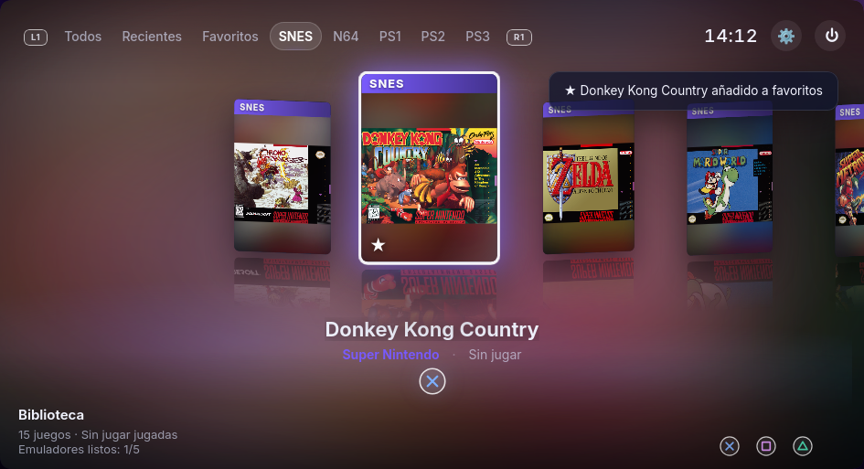

<div align="center">

# EmuHub

**Tu colección retro, en un solo lugar.**
Un lanzador de código abierto que reúne SNES, Nintendo 64, PlayStation, PlayStation 2 y PlayStation 3
bajo una interfaz de consola moderna, con los emuladores ya incluidos.

[Descargar](../../releases) · [Cómo funciona](#cómo-funciona) · [Hoja de ruta](#hoja-de-ruta) · [Compilar](#compilar-desde-el-código)



</div>

---

## Por qué existe

Jugar a clásicos en un PC hoy significa instalar cinco emuladores distintos, cada uno con su
interfaz, su configuración, sus carpetas de BIOS y sus atajos. Si además quieres jugar con amigos,
cada uno acaba con versiones diferentes, configuraciones incompatibles y una tarde perdida
intentando que todo funcione igual en todos los ordenadores.

EmuHub nace para resolver eso:

- **Un único sitio para toda tu colección.** Tus juegos de cinco consolas, con portadas, favoritos,
  recientes y tiempo jugado, en un carrusel pensado para jugar desde el sofá con mando.
- **Los mismos emuladores para todos.** Cada release trae versiones fijadas (con checksum verificado)
  de emuladores de código abierto, embebidas en un solo ejecutable. Si tú y tus amigos usáis la misma
  versión de EmuHub, usáis exactamente los mismos emuladores.
- **Cero configuración para empezar.** Abres el ejecutable, apuntas a tu carpeta de juegos y juegas.
  EmuHub sabe cómo lanzar cada emulador con los parámetros correctos.
- **Construido sobre el ecosistema open source.** Snes9x, RMG/Mupen64Plus, ares, DuckStation, PCSX2 y
  RPCS3 son el resultado de décadas de trabajo de la comunidad. EmuHub no los sustituye: los reúne,
  los presenta bien y da crédito y enlace al código de cada uno.

La preservación del videojuego depende de que estos clásicos sigan siendo **jugables** y **fáciles de
compartir como experiencia**. EmuHub quiere ser la puerta de entrada.

## Qué incluye

| | SNES | N64 | PS1 | PS2 | PS3 |
|---|---|---|---|---|---|
| **Windows / Linux** | Snes9x 1.63 | RMG 0.9.0 | DuckStation v0.1-12083 | PCSX2 2.8.2 | RPCS3 0.0.43 |
| **macOS** | Snes9x 1.63 | ares v148 | DuckStation v0.1-12083 | PCSX2 2.8.2 | RPCS3 0.0.43 |

### Funcionalidades

- 🎮 **Interfaz estilo consola**: carrusel 3D con reflejos, fondo dinámico según el juego, reloj y atajos visibles.
- 🕹️ **Mando, teclado y ratón**: navegación completa con mando (Xbox, DualShock, DualSense…).
- 📦 **Emuladores embebidos**: un único ejecutable por sistema; se descomprimen solos en el primer arranque.
- 🔍 **Escaneo automático** de carpetas de juegos, sin duplicar pistas `.bin`/`.cue` ni discos de `.m3u`.
  Los juegos de PS3 en carpeta se leen desde `PARAM.SFO` (título, ID e iconos oficiales).
- 🖼️ **Portadas automáticas** desde [libretro-thumbnails](https://github.com/libretro-thumbnails), o las tuyas propias.
- ✅ **Validación antes de jugar**: comprueba BIOS y firmware y los coloca donde cada emulador los espera.
- ⭐ **Favoritos, recientes y tiempo de juego** por título.
- 🔧 **Emulador propio opcional**: puedes usar cualquier emulador instalado en tu sistema con un comando personalizado.

## Cómo funciona

1. **Descarga** el ejecutable de tu sistema desde [Releases](../../releases).
2. **Ábrelo.** La primera vez prepara los emuladores incluidos (unos segundos).
3. En **Ajustes** (`O` u *Options*), añade la carpeta de juegos de cada consola y pulsa *Escanear*.
4. Para PS1, PS2 y PS3, deja tu BIOS o firmware en `~/ROMs/bios/<consola>/` (ver abajo).
5. Elige un juego y pulsa ✕ / A / Enter.

### Juegos, BIOS y firmware: lo que NO incluye

EmuHub **no incluye ni distribuye juegos, BIOS ni firmware**: tienen copyright y cada persona debe
usar copias propias (por ejemplo, volcadas de sus discos y consolas) o juegos homebrew/libres.
Lo que sí hace es validarlos antes de cada partida. La BIOS y el firmware van siempre en la misma
carpeta, que EmuHub crea al arrancar (en Windows, `~` es tu carpeta de usuario):

```
~/ROMs/bios/
├── ps1/    BIOS de PS1, p. ej. SCPH1001.BIN
├── ps2/    BIOS de PS2
└── ps3/    PS3UPDAT.PUP
```

| Requisito | Validación | Qué hace EmuHub |
|---|---|---|
| BIOS PS1 | archivos de 512 KB con la firma de Sony | los copia a la carpeta `bios` de DuckStation |
| BIOS PS2 | archivos de 4 MB con ROMDIR (`RESET`, `ROMVER`) | los copia a la carpeta `bios` de PCSX2 |
| Firmware PS3 (`PS3UPDAT.PUP`) | cabecera `SCEUF` | lo instala en RPCS3 la primera vez |

El firmware de PS3 se descarga gratis desde la web oficial de PlayStation. Si falta algo, el juego no
se lanza y EmuHub abre los ajustes de esa consola indicando qué falta. El escáner nunca muestra estos
archivos como juegos: ignora las BIOS válidas y las carpetas llamadas `bios`, `firmware` o `system`.

### Primera ejecución en cada sistema

- **Windows**: SmartScreen avisará porque el ejecutable no está firmado → *Más información → Ejecutar de todas formas*.
- **macOS**: descarga la versión `arm64` (Apple Silicon) o `amd64` (Intel). La primera vez: clic derecho → *Abrir*, o `xattr -cr EmuHub.app`.
- **Linux**: `chmod +x EmuHub-*-linux-x86_64`. Requiere WebKitGTK 4.1 (`libwebkit2gtk-4.1`), presente en casi todos los escritorios.

### Controles

| Acción | Teclado | Mando |
|---|---|---|
| Navegar | ← → | D-pad / stick |
| Jugar | Enter | ✕ / A |
| Cambiar categoría | Q / E | L1 / R1 |
| Favorito | F | □ / X |
| Menú del juego | M | Share / View |
| Reescanear | R | △ / Y |
| Ajustes | O | Options / Menu |
| Atrás | Esc | ○ / B |

## Hoja de ruta

### 🌐 Juego remoto con amigos (próximamente)

El siguiente gran objetivo es algo en la línea de **Remote Play Together**: jugar en línea con
amigos a juegos que solo tienen multijugador local, **compartiendo un enlace**.

La idea:

1. El anfitrión abre un juego en EmuHub y pulsa **Invitar**.
2. EmuHub genera un **enlace o código de sala** que se comparte por cualquier chat.
3. El invitado lo abre (en su EmuHub o incluso en el navegador) y entra como **jugador 2, 3 o 4**,
   sin necesitar el juego ni configurar nada.

Enfoques que estamos evaluando:

- **Streaming desde el anfitrión** (estilo Parsec/Moonlight): el anfitrión emite vídeo y audio por
  WebRTC y recibe los mandos de los invitados. Funciona con cualquier emulador y solo el anfitrión
  necesita el juego. El reto es la latencia.
- **Netplay nativo de los emuladores** (rollback/lockstep, como RetroArch o el netplay de
  RMG/Mupen64Plus): cada jugador ejecuta el emulador en local y se sincronizan las entradas. Latencia
  mínima, pero todos necesitan el mismo juego y la misma versión del emulador, algo que EmuHub ya
  garantiza al embeber versiones fijadas.
- **Servidor de señalización ligero** para crear salas y atravesar NAT (STUN/TURN), de forma que
  compartir una URL sea suficiente.

### Otras ideas

- Más consolas (GameCube/Wii con Dolphin, GBA, PSP…).
- Guardado y sincronización de partidas.
- Metadatos enriquecidos (año, género, descripción) y búsqueda.
- Temas visuales.
- Firma de los ejecutables para evitar los avisos de Windows y macOS.

¿Ideas o ganas de ayudar? Abre un *issue* o un *pull request*.

## Compilar desde el código

**Tecnología**: [Wails v2](https://wails.io) (Go + WebView nativo), React + TypeScript + Vite. Un binario
nativo, sin Electron. Los datos se guardan en local: `~/.config/emuhub/library.json` y `~/.config/emuhub/covers/`.

Requisitos: Go, Node.js, el CLI de Wails (`go install github.com/wailsapp/wails/v2/cmd/wails@latest`)
y, en Linux, `libgtk-3-dev` y `libwebkit2gtk-4.1-dev`.

```bash
wails dev                                # desarrollo con recarga en caliente (sin emuladores embebidos)
wails build                              # binario sin emuladores (usa los del sistema)
scripts/build-release.sh linux-amd64     # release con emuladores embebidos (Linux)
scripts/build-release.sh windows-amd64   # desde Linux o Windows
scripts/build-release.sh darwin-arm64    # desde macOS (también darwin-amd64)
```

### Releases automáticas

El workflow [`release.yml`](.github/workflows/release.yml) compila Linux, Windows y macOS (arm64 e Intel):

- Cada push a `main` y cada pull request ejecuta los tests y genera los binarios como *artifacts*.
- Al publicar un tag `v*` (`git tag v0.1.0 && git push --tags`) se crea una **GitHub Release** con todos los ejecutables.

### Emuladores embebidos

`emulators.lock.json` fija cada emulador por plataforma (URL, SHA-256, comando de lanzamiento y dónde
espera la BIOS). `cmd/bundler` descarga cada release, verifica su checksum y la desempaqueta **sin
ejecutar nada** (los AppImage se leen directamente como squashfs). El resultado se embebe en el
binario con `-tags bundle`. Para actualizar un emulador basta con editar el lockfile y subir `bundleVersion`.

`firstRun` evita el asistente inicial de un emulador: si falta su configuración, EmuHub la crea desde una
plantilla de `internal/bundle/seeds/`, generada por la versión fijada. Si actualizas ese emulador, regenera
también su plantilla. También añade la asignación de mando (`controls`), que sirve para Xbox y PlayStation
porque SDL identifica los botones por su posición.

### Estructura

```
main.go, app.go, launch.go   arranque, API expuesta a la UI, validación y lanzamiento
internal/library/            consolas, escaneo, PARAM.SFO, portadas, requisitos (BIOS/firmware), persistencia
internal/bundle/             emuladores embebidos: manifiesto, extracción, rutas por sistema, primer arranque
cmd/bundler/                 empaquetador de emuladores (build-time)
frontend/src/                interfaz (carrusel, ajustes, entrada de mando)
emulators.lock.json          versiones fijadas de los emuladores
```

## Licencias

El código de EmuHub se publica bajo licencia [MIT](LICENSE).

Los emuladores incluidos conservan sus propias licencias, visibles en *Ajustes → General* con enlace a
su código fuente: Snes9x (licencia propia, uso no comercial), RMG (GPL-3.0), ares (ISC),
DuckStation (CC BY-NC-ND 4.0), PCSX2 (GPL-3.0) y RPCS3 (GPL-2.0). Por las licencias no comerciales de
algunos de ellos, **las releases de EmuHub con emuladores embebidos no pueden venderse**.

EmuHub no está afiliado a Nintendo ni a Sony. Todas las marcas pertenecen a sus respectivos dueños.
